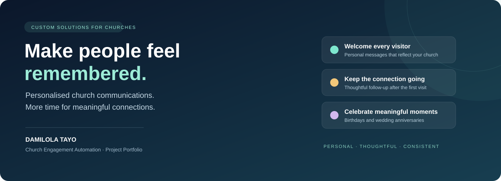

<strong>Help every visitor feel welcomed. Help every member feel remembered.</strong>

Custom automation services by <a href="https://github.com/DamiTayo">Damilola Tayo</a>

## Give your team more time for people

Welcoming visitors, checking on them after Sunday service and celebrating members' special occasions all matter. Keeping up with those messages manually can become a burden for a busy church administration team.

I help churches organise these communications through personalised automation, shaped around their ministry, preferred wording and existing administrative tools.

**Looking for a similar system for your church? [Let's discuss your project on LinkedIn.](https://www.linkedin.com/in/damilola-ojo-7378b0200/)**

## What your church can offer

| Service | Experience for your people |
| --- | --- |
| **Personalised visitor welcome** | A warm message after registration, addressed to the visitor by name. |
| **Scheduled visitor check-in** | A thoughtful follow-up that keeps the connection going after the first visit. |
| **Birthday greetings** | Christian birthday messages using each member's chosen title and name. |
| **Wedding anniversary greetings** | Meaningful messages delivered individually to each registered spouse. |

Your church's voice stays at the centre. Message wording, greetings, branding and timing are agreed with your team.

## A practical church administration project

This showcase draws on a church engagement project developed for an administration use case in Ibadan, Nigeria. It combined visitor welcome and follow-up with birthday and wedding anniversary communications.

The work included personalised greetings, scheduled outreach, communication history and checks intended to reduce repeated messages. Visitor email delivery was observed during development; celebration messages were checked through controlled previews. These observations demonstrate the implementation work, without implying guaranteed delivery or measured business results.

**Technology experience:** n8n, Google Forms, Google Sheets, Gmail and Google Apps Script.

## What an engagement can include

- A system adapted to your registration and communication needs.
- Personalised email wording approved by your church.
- Scheduling aligned with your services and local time.
- Controlled testing before launch.
- Administrator guidance and agreed ongoing support.

Scope, hosting, account access, maintenance and handover terms are agreed for each project. The service is configured for the organisation commissioning it.

## Start a conversation

Tell me about your church, the communication tasks taking up your team's time and the experience you want visitors and members to have.

**[Contact Damilola Tayo on LinkedIn →](https://www.linkedin.com/in/damilola-ojo-7378b0200/)**

[View my GitHub profile](https://github.com/DamiTayo)

---

This is a service portfolio. Implementation files, source code, internal configuration and technical processes are kept private. No member records or account credentials are published. Public presentation material may be viewed, but this repository grants no licence to copy the implementation or use the branding.
